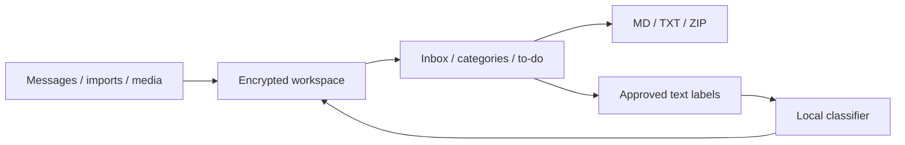

# Note Chat

An offline Android notebook with a chat interface and a classifier that learns from approved labels. One inbox holds every message; category chats are views of the same records.

 

## Features

- Thoughts, ideas, to-dos, questions, links, junk/code, work, and custom categories.
- Approval-based learning. Unsorted contains active messages awaiting approval; batch reclassification refreshes their suggestions.
- Markdown, links, images, voice notes, replies, search, stars, and multiple selection. Text can be split in place or merged.
- TXT/Markdown import and category export as MD, TXT, or ZIP with attachments.
- A continuous to-do list and home-screen widget. Completed tasks archive after 24 hours; deleted messages remain recoverable for 90 days.
- Dark mode, encrypted storage, and fingerprint or device-credential unlock.

The built-in classifier requires no download. Optional MiniLM adds sentence embeddings; optional Vosk transcribes English recordings locally. No account or backend is required.

## Architecture

The classifier combines wording features, approved-example memory, and a small trainable head. A held-out comparison controls adoption of learned weights. Messages and attachments use AES-GCM encryption; Android Keystore protects the data key.

| Directory | Contents |
| --- | --- |
| `android/` | Native Kotlin app, storage, widget, classifier, and tests |
| `desktop/` | Python organizer, browser interface, and encoder-training tools |
| `archive/v1/` | Original SVM implementation, working model, notebooks, and report |
| `docs/` | Architecture reference and screenshots |

The app requires Android 11 or later on ARM64. The Android build uses JDK 17, SDK 35, and the included Gradle wrapper. CI checks the app and desktop organizer; tagged versions produce draft signed releases.

[Architecture and learning](docs/architecture.md) · [Apache 2.0 license](LICENSE) · [Third-party notices](NOTICE)
