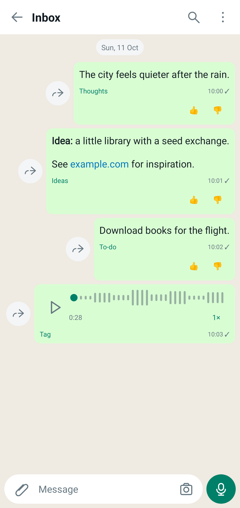
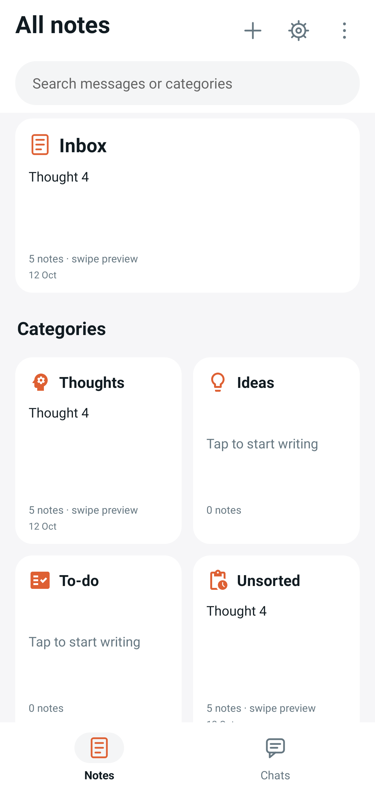
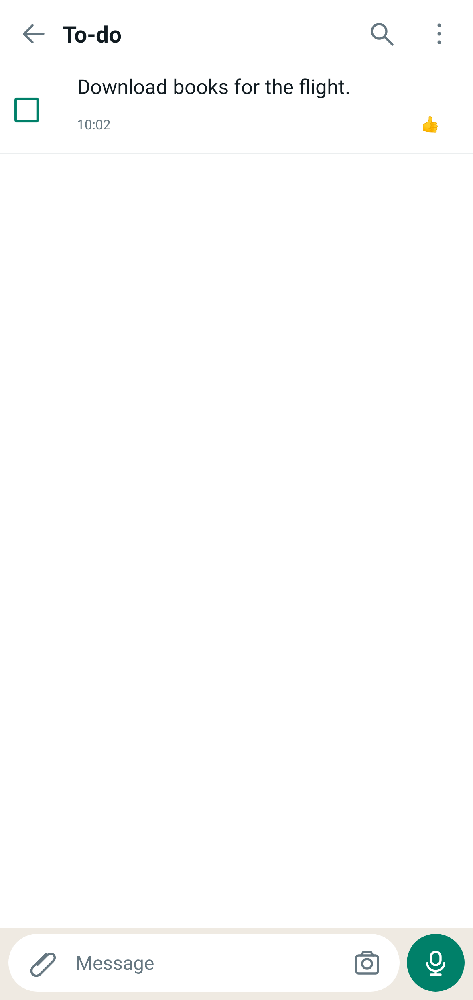
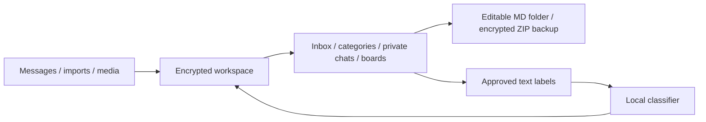

# Note Chat

An Android notebook with a familiar chat interface, a notes grid, and an on-device classifier that learns from confirmed labels. The inbox and category views share the same records.

  

## Features

- Thoughts, ideas, to-dos, questions, links, junk/code, work, and custom categories.
- Learning from thumbs-up and manual tags. Unsorted holds messages awaiting approval; private chats stay outside classification. Batch reclassification and a ten-note test make progress measurable.
- Markdown, file links, images, voice notes, replies, pinned messages, search, stars, and multiple selection. Text can be split in place or merged.
- TXT/Markdown and WhatsApp ZIP import, editable category files, and MD/TXT export. A permanent folder restores notes after reinstall; password-encrypted ZIP backups support device or Drive storage.
- A continuous to-do list and home-screen widget. Completed tasks archive after 24 hours; deleted messages remain recoverable for 90 days.
- Dark mode, encrypted storage, fingerprint or device-credential unlock, and individual chat shortcuts. Optional MODs add transcription, translation, image text extraction, and reminders.

The built-in classifier requires no extra download. Optional MiniLM adds sentence embeddings. Optional Vosk transcribes English recordings locally. Translation and OCR use Google ML Kit and downloadable models: content is processed on-device, while SDK usage and performance metrics are sent to Google. No app account or classification server is required.

## Architecture

The classifier combines wording features, approved-example memory, and a small trainable head. A held-out comparison controls adoption of learned weights. Messages and attachments use AES-GCM encryption; Android Keystore protects the data key.

## Technical components

The Android classifier is implemented in Kotlin. It combines a 524-dimensional feature vector with a balanced softmax head: 12 intent and formatting cues, 128 hashed token features, and 384 optional sentence-embedding dimensions. Without MiniLM, the embedding slots remain zero. Starter weights are fitted from category examples; exact approved-message matches take precedence, and MiniLM enables similarity matching against approved notes.

Thumbs-up or manual categorization supplies a training label. With at least six distinct approvals per category, the app fits a regularized personal head and compares it with the starter on a stable hold-out split. Held-out text is excluded from fitting, seed examples, and correction memory during evaluation. The encoder stays frozen; this is head training and example memory rather than on-device transformer fine-tuning.

| Component | Implementation |
| --- | --- |
| Sentence encoder | Optional INT8 `all-MiniLM-L6-v2`, WordPiece tokenization, ONNX Runtime, checksum-verified download |
| Local storage | AES-GCM snapshots and attachments; Android Keystore; biometric or device-credential authentication |
| Markdown integration | Android document-tree access, stable IDs, three-way reconciliation, conflict copies, Obsidian-style links, idle/background saves |
| Portable backups | Password-derived AES-GCM ZIP archives, attachment recovery, duplicate-ID detection, private head export/import |
| Chat rendering | Native Views and RecyclerView; Markwon for Markdown; Material Components and Material icons |
| Voice and MODs | Android recording/playback and image controls; optional Vosk, ML Kit translation/OCR, and AlarmManager reminders |
| Evaluation | Stable held-out macro F1, manual ten-note checks, session classification latency, whole-app PSS |
| Launcher widget | RemoteViews checklist; opt-in device-encrypted task projection for display while the app is locked |
| Build and release | Kotlin, JDK 17, Gradle, unit/UI tests, lint, and signed APK/AAB drafts through GitHub Actions |

### Original SVM

The v1 implementation uses word and character TF-IDF, 15 engineered features, and a calibrated LinearSVC to distinguish questions, tasks, and deadlines. Rule adjustments and a separate date parser handle question/action wording and dates. Its retained evaluation reports macro F1 of 0.9378 on the original, heavily question-weighted test set. That result describes the historical three-class experiment, not the Android app or personal-note accuracy.

## Chat interface

The chat layout follows the familiar habit of sending notes to oneself. Notes and private Chats have separate bottom tabs. Private messages stay out of Inbox unless enabled in Display settings. The notes layout has a wide Inbox, two category boards per row, and a private-chat grid below. Previews scroll horizontally; boards open as editable document pages. A guided walkthrough highlights real controls and retains progress, drafts, cursors, and scroll positions.

Reusable native controls live in `android/app/src/main/java/dev/notechat/ui/chat/`: message bubbles, swipe-to-reply, quoted previews, list navigation, recording controls, waveforms, and media views. The directory shares the app's Kotlin package and is not a standalone library. Reuse involves copying the required controls, supplying message/attachment types for previews, and wiring callbacks to the host app's storage and actions. RecyclerView, Material Components, and Markwon provide the list, dialogs, and Markdown dependencies.

| Directory | Contents |
| --- | --- |
| `android/` | Native Kotlin app, storage, widget, classifier, and tests |
| `desktop/` | Python organizer, browser interface, and encoder-training tools |
| `archive/v1/` | Original SVM implementation, working model, notebooks, and report |
| `docs/` | Architecture reference and screenshots |

The app requires Android 11 or later on ARM64. The Android build uses JDK 17, SDK 35, and the included Gradle wrapper. CI checks the app and desktop organizer; tagged versions produce draft signed releases.

[Architecture and learning](docs/architecture.md) · [Apache 2.0 license](LICENSE) · [Third-party notices](NOTICE)
